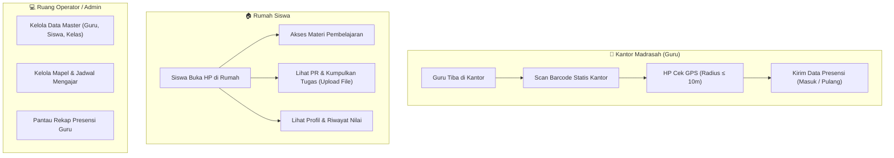

Penjelasan konsep Anda ini **sangat realistis, praktis, dan sesuai dengan kondisi nyata madrasah** (di mana siswa memang dilarang membawa HP ke sekolah, dan guru butuh presensi yang praktis tanpa ribet cetak QR berulang kali).

Berikut rancangan struktur database dan cara kerja sistem yang disesuaikan persis dengan kebutuhan Anda:

---

### 1. Konsep & Alur Kerja Database Sesuai Peran (Role)

---

### 2. Logika Cerdas: Presensi Guru (QR Statis + Geofencing 10m)

Agar admin **tidak perlu cetak barcode setiap hari**:
1. **QR Code Tetap (Statis)**: 
   - Kantor madrasah hanya ditempeli satu lembar QR Code akrilik/kertas laminasi permanen.
   - Isi QR Code bisa berupa string rahasia/token unik madrasah, misalnya: `MTS-ALHUDA-OFFICE-GATE-2026`.
2. **Validasi Ganda di Server (Keamanan)**:
   - Saat guru memindai QR tersebut, aplikasi Flutter otomatis mengambil titik koordinat GPS HP guru saat itu (`latitude`, `longitude`).
   - Server memverifikasi dua hal:
     1. Apakah kode QR yang di-scan valid (`token` kantor cocok)?
     2. Apakah jarak koordinat HP guru dengan koordinat kantor $\le 10$ meter?
   - Jika kedua syarat terpenuhi, sistem mencatat presensi masuk/pulang. Dengan ini, guru **tidak bisa titip absen / foto barcode dari rumah**.

---

### 3. Struktur Tabel Database yang Disederhanakan & Efisien

Dengan batasan kebutuhan yang Anda jelaskan, struktur tabelnya jadi jauh lebih rapi dan fokus:

#### 📌 Modul 1: Pengguna & Master Data (Dikelola Penuh oleh Admin)
1. **`users`**: Akun login (Admin, Guru, Siswa).
   - CREATE DATABASE IF NOT EXISTS madrasahku
CHARACTER SET utf8mb4
COLLATE utf8mb4_unicode_ci;

USE madrasahku;

CREATE TABLE Pengguna (
    id BIGINT UNSIGNED AUTO_INCREMENT PRIMARY KEY,
    username VARCHAR(50) NOT NULL UNIQUE,
    password VARCHAR(255) NOT NULL,
    email VARCHAR(100) NULL UNIQUE,
    role ENUM('admin', 'teacher', 'student')
        NOT NULL DEFAULT 'student',
    account_status ENUM('active', 'inactive')
        NOT NULL DEFAULT 'active',
    created_at TIMESTAMP DEFAULT CURRENT_TIMESTAMP,
    updated_at TIMESTAMP DEFAULT CURRENT_TIMESTAMP
        ON UPDATE CURRENT_TIMESTAMP
);
2. **`gurus`**: Data pendidik.
   - CREATE TABLE guru ( 
    id_guru INT AUTO_INCREMENT PRIMARY KEY, 
    nama_lengkap VARCHAR(100) NOT NULL, 
    nip_nuptk VARCHAR(30) DEFAULT NULL, 
    mata_pelajaran VARCHAR(100) NOT NULL, 
    email VARCHAR(100) NOT NULL, 
    no_telepon VARCHAR(20), 
    foto VARCHAR(255) DEFAULT NULL, 
    status ENUM('Aktif', 'Nonaktif') DEFAULT 'Aktif', 
    created_at TIMESTAMP DEFAULT CURRENT_TIMESTAMP, 
    updated_at TIMESTAMP DEFAULT CURRENT_TIMESTAMP 
        ON UPDATE CURRENT_TIMESTAMP 
);
3. **`siswas`**: Data murid.
   - CREATE TABLE siswa ( 
    id_siswa INT AUTO_INCREMENT PRIMARY KEY, 
    nama_lengkap VARCHAR(100) NOT NULL, 
    nis VARCHAR(30) NOT NULL UNIQUE, 
    id_kelas INT, 
    jenis_kelamin ENUM('Laki-laki', 'Perempuan') NOT NULL, 
    tanggal_lahir DATE, 
    foto VARCHAR(255) DEFAULT NULL, 
    status ENUM('Aktif', 'Nonaktif') DEFAULT 'Aktif', 
    created_at TIMESTAMP DEFAULT CURRENT_TIMESTAMP, 
    updated_at TIMESTAMP DEFAULT CURRENT_TIMESTAMP 
        ON UPDATE CURRENT_TIMESTAMP 
); 
4. **`classes` (Kelas)**:
   - `id`, `nama_kelas` (VII A, VII B, dst.), `wali_kelas_id` (FK ke guru).
5. **`subjects` (Mata Pelajaran)**:
   - `id`, `kode_mapel`, `nama_mapel`.
6. **`schedules` (Jadwal Mengajar)**:
   - `id`, `kelas_id`, `subject_id`, `guru_id`, `hari`, `jam_mulai`, `jam_selesai`.

---

#### 📌 Modul 2: Presensi Guru (Khusus Guru Saja)
1. **`school_locations`** *(Pengaturan Titik Kantor oleh Admin)*:
   - `id`, `nama_titik` ("Kantor Guru"), `latitude`, `longitude`, `radius_meter` (contoh: 10), `qr_secret_token`.
2. **`teacher_attendances`** *(Catatan Kehadiran Guru)*:
   - `id`, `guru_id` (FK).
   - `tanggal` (DATE).
   - `jam_masuk` (TIME, misal: 06.45).
   - `jam_pulang` (TIME, misal: 14.15).
   - `latitude_masuk`, `longitude_masuk`.
   - `latitude_pulang`, `longitude_pulang`.
   - `status` (`hadir`, `terlambat`, `izin`, `sakit`).

---

#### 📌 Modul 3: Pembelajaran & PR (Guru & Siswa di Rumah)
1. **`materials` (Bahan Ajar & Materi)**:
   - `id`, `guru_id` (FK), `subject_id` (FK), `kelas_id` (FK).
   - `judul`, `deskripsi`, `file_path` (PDF/PPT/Ringkasan).
   - `created_at`.
2. **`assignments` (Tugas PR)**:
   - `id`, `guru_id` (FK), `subject_id` (FK), `kelas_id` (FK).
   - `judul_tugas`, `instruksi_pr`, `deadline` (tanggal & jam batas kumpul).
3. **`assignment_submissions` (Pengumpulan PR Siswa)**:
   - `id`, `assignment_id` (FK ke tugas), `siswa_id` (FK ke siswa).
   - `file_jawaban` (foto buku tulis/PDF hasil kerja siswa).
   - `catatan_siswa`.
   - `submitted_at` (waktu siswa mengumpulkan).
   - `nilai` (angka 0 - 100, diisi saat guru menilai).
   - `catatan_guru` (evaluasi/koreksi dari guru).

---

### 4. Ringkasan Hak Akses (Matrix CRUD)

| Data / Fitur | Admin | Guru | Siswa | Keterangan |
| :--- | :---: | :---: | :---: | :--- |
| **Data Guru, Siswa, Kelas, Mapel** | Full (CRUD) | Lihat saja | - | Dikelola Admin |
| **Jadwal Pelajaran** | Kelola | Lihat miliknya | - | Guru melihat jadwal mengajarnya |
| **Presensi QR & Radius 10m** | Pantau rekap | Scan masuk/pulang | - | Hanya Guru di kantor |
| **Materi Pembelajaran** | - | Buat & Upload | Baca & Unduh | Siswa akses dari rumah |
| **Tugas / PR** | - | Buat tugas | Kerjakan & Upload | Dikerjakan siswa di rumah |
| **Penilaian PR** | - | Beri nilai | Lihat nilai | Siswa melihat hasil koreksi |

Konsep ini **sangat solid**: tidak ada tabel mubazir, alurnya jelas, dan sangat mudah dipertanggungjawabkan saat sidang progres atau demonstrasi ke dosen/penguji.
